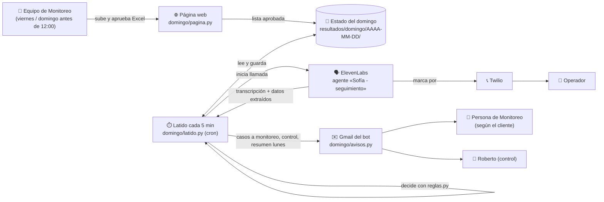
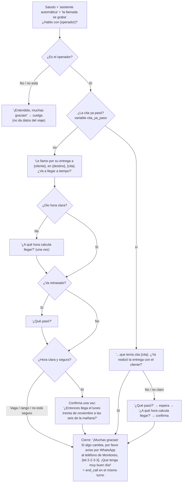
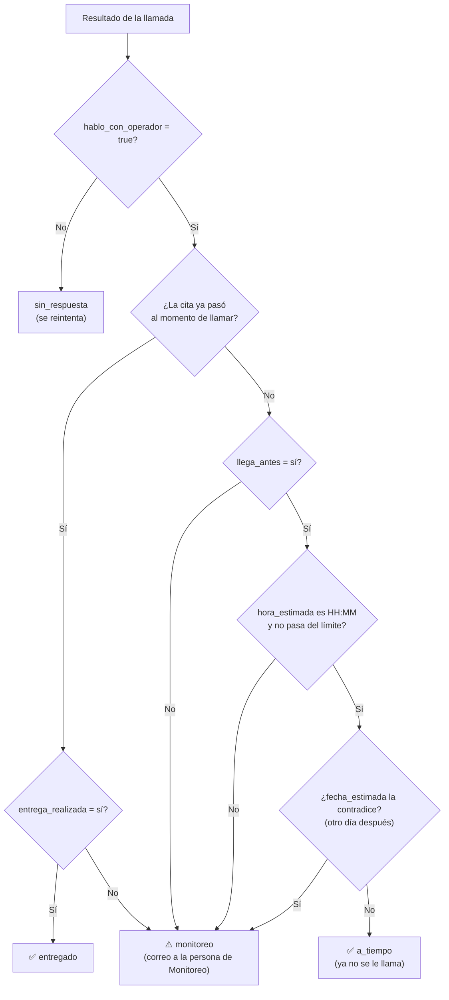
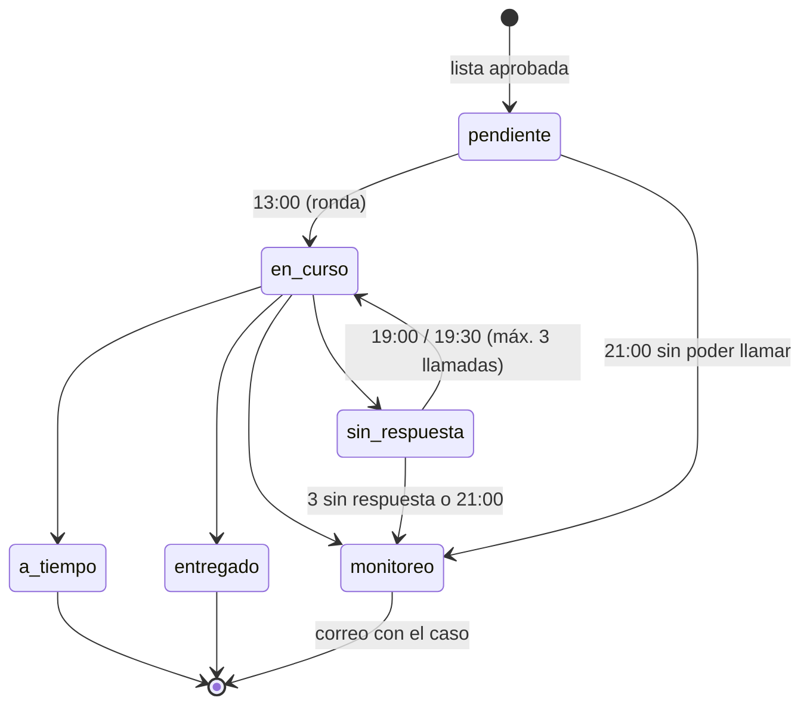
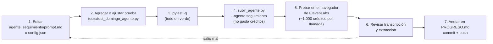
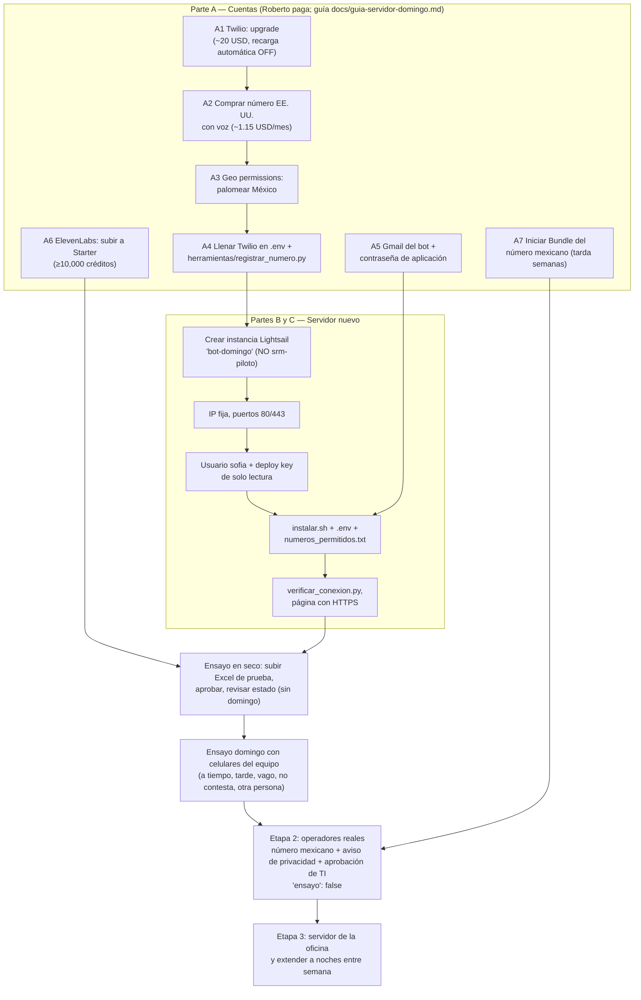

# Entrega del proyecto: Sofía, el bot de seguimiento de entregas

**Fecha de entrega:** 2026-11-25 · **Dueño del proyecto:** Roberto · **Repositorio:** `robertolerma07/bot-citas-daltile` (rama `master`, privado)

Este documento es el punto de entrada. Léelo completo una vez; después úsalo como mapa. Los diagramas están en Mermaid:
se ven dibujados en GitHub y en VS Code (con la extensión *Markdown Preview Mermaid Support*).

---

## 1. Qué es, en una página

Los domingos (y más adelante en las noches) el equipo de Monitoreo no está, pero los camiones siguen en ruta hacia los
distribuidores. **Sofía** es una asistente de voz que **llama a cada operador** el domingo para preguntarle si llega a
tiempo a su cita del lunes en la mañana. Lo que no está bien (va tarde, no sabe, no contesta) **llega por correo a la
persona de Monitoreo** de ese cliente, para que el lunes a las 7:30 ya sepa qué atender.

- **La voz** la pone ElevenLabs (agente conversacional) y **la línea telefónica** Twilio.
- **El código** (Python) decide a quién llamar, cuándo, qué significa cada respuesta y a quién avisar. **Sofía solo
  conversa y extrae datos; la decisión la toma el código** (`domingo/reglas.py`).
- **El equipo** sube un Excel con los viajes en una página web con contraseña y lo aprueba antes de las 12:00.



### Historia corta
1. **Prueba de concepto (Fases 0–4, nov 19–20):** agente "Sofía" de **avisos de cita** (carpeta `agente/`). Sirvió para
   aprender ElevenLabs y Twilio; sigue en el repo pero no es el producto actual.
2. **MVP de domingo (nov 24–25):** agente nuevo **"Sofía - seguimiento"** (`agente_seguimiento/`), paquete `domingo/`,
   página, latido, correos, despliegue. Fusionado a `master`. Probado en el navegador de ElevenLabs con 5 casos.
3. **Siguiente:** cuentas reales (Twilio pagado, Gmail del bot), servidor nuevo en AWS Lightsail, ensayo con el equipo.

---

## 2. Dónde está cada cosa

| Carpeta / archivo | Qué es | ¿Lo vas a tocar seguido? |
|---|---|---|
| `agente_seguimiento/prompt.md` | **Lo que dice y hace Sofía** en la llamada de domingo | ✅ Sí |
| `agente_seguimiento/config.json` | Voz, modelo, tiempos, duración máxima (90 s), **datos que se extraen** de cada llamada | ✅ Sí |
| `agente/subir_agente.py` | Sube el prompt y la config a ElevenLabs y comprueba que quedaron igual | ✅ Sí (lo corres) |
| `domingo/reglas.py` | **Lógica pura**: a quién llamar y qué significa cada resultado (`decidir`) | A veces |
| `domingo/latido.py` | El reloj: cada 5 min llama, reintenta, cierra rondas, manda correos | A veces |
| `domingo/viajes.py` | Lee y valida el Excel; arma las variables que se le pasan a Sofía | A veces |
| `domingo/pagina.py` + `plantillas_html/` | Página web (Flask): entrar, subir, revisar, aprobar, detener, ver estado | A veces |
| `domingo/telefonia.py` | Hace la llamada saliente por la API de ElevenLabs y lee el resultado | Rara vez |
| `domingo/avisos.py` | Correos por Gmail (único punto de envío; ahí se agregaría WhatsApp/SMS) | Rara vez |
| `domingo/almacen.py` | Guarda aprobación y estados en JSON, con escritura atómica y candado | Rara vez |
| `domingo/calendario.py` + `config/domingo.json` | **Horarios del domingo** (ronda, reintentos, ventana, topes, modo ensayo) | Al cambiar horarios |
| `lib/formato_voz.py` | Convierte fechas, horas y teléfonos a texto hablado ("el lunes treinta de noviembre") | Rara vez |
| `lib/seguridad.py` | Candados: lista blanca, horario, keys enmascaradas, `.env` | Casi nunca |
| `despliegue/` | `instalar.sh`, servicio systemd, Caddy (HTTPS), crontab | Al montar el servidor |
| `datos/viajes_prueba.xlsx` | Viajes **ficticios** de ejemplo (el primero se carga en el agente) | No |
| `plantillas/viajes_domingo.xlsx` | Plantilla vacía del Excel que llena el equipo | No |
| `tests/` | 330 pruebas automáticas (`pytest`) | ✅ Al cambiar código |
| `PROGRESO.md` | **Bitácora**: qué se hizo, cada prueba, cada decisión, con fecha | ✅ Escribe ahí |
| `docs/guia-servidor-domingo.md` | Paso a paso de cuentas (Parte A) y servidor (Partes B–E) | Al montar |
| `docs/superpowers/specs/2026-11-24-seguimiento-domingo-design.md` | **Diseño acordado con Roberto** (la autoridad si hay dudas) | Consulta |
| `docs/superpowers/plans/2026-11-24-seguimiento-domingo.md` | Plan de implementación (ya ejecutado) | Consulta |

**Fuera de git (nunca se suben):** `.env` (keys), `config/numeros_permitidos.txt` (celulares reales),
`resultados/` (transcripciones y estados), `.venv/`.

---

## 3. El domingo, hora por hora

Todas las horas son de Ciudad de México (el servidor puede estar en otra zona; el código siempre convierte).
Se configuran en `config/domingo.json`.

```mermaid
gantt
    title Domingo de seguimiento (hora de CDMX)
    dateFormat HH:mm
    axisFormat %H:%M
    section Equipo
    Subir y aprobar el Excel (la última aprobación manda) :a1, 00:00, 12:00
    section Bot
    Sin lista aprobada → correo a Roberto, no se llama   :milestone, 12:00, 0m
    Ronda única: se llama a TODOS los viajes            :r1, 13:00, 60m
    Correo de casos (al terminar la ronda)             :milestone, 14:00, 0m
    Reintento 1 (solo quien no contestó)                :r2, 19:00, 30m
    Reintento 2 (solo quien tampoco contestó)           :r3, 19:30, 30m
    Correo de casos (al terminar el reintento 2)       :milestone, 20:00, 0m
    Fin de la ventana: lo pendiente pasa a monitoreo     :milestone, 21:00, 0m
```



- **Lunes 7:00:** resumen a cada persona de Monitoreo (sus viajes) y a Roberto (todos, con Excel adjunto).
- **Topes:** máximo 3 llamadas por viaje, 10 minutos entre llamadas al mismo teléfono, 150 llamadas por domingo.
- **Rango de citas que se esperan:** domingo 13:00 a lunes 13:00 (fuera de ese rango, el validador advierte "¿seguro?").
- **Citas de "Día":** límite 16:00 si la columna `hora` va vacía; algunos clientes tienen otro límite y se escribe ahí.
  **Citas de "Hora":** hora fija, **sin tolerancia**.
- **Botón "Detener las llamadas de hoy"** en la página: el único freno si se aprobó una lista equivocada.

---

## 4. La llamada

Sofía dura entre 30 y 60 segundos (máximo 90). El flujo vive en `agente_seguimiento/prompt.md`; este diagrama lo resume.



**Lo que Sofía extrae** (en `config.json → extraccion_de_datos`, ElevenLabs lo llena al terminar):

| Campo | Valores | Ejemplo |
|---|---|---|
| `hablo_con_operador` | true / false | true |
| `llega_antes_de_la_cita` | sí / no / no sabe | sí |
| `entrega_realizada` | sí / no / no aplica | no aplica |
| `hora_estimada_dicha` | texto tal como lo dijo | "a las seis" |
| `hora_estimada` | HH:MM o vacío (**nunca inventado**) | 06:00 |
| `fecha_estimada` | AAAA-MM-DD o vacío | 2026-11-30 |
| `motivo` | texto | "se descompuso el camión" |

---

## 5. Cómo decide el código

`domingo/reglas.py → decidir()`. Regla de Roberto: **"a tiempo" solo con certeza**; ante la duda, a Monitoreo.



### Estados de un viaje durante el domingo



`en_curso` se guarda **antes** de esperar el resultado: si el proceso se cae, el siguiente latido recupera la
conversación por su ID. Si la API de ElevenLabs falla seguido, el latido suspende las llamadas y prueba de nuevo.

---

## 6. Cómo se trabaja (el ciclo de un cambio)

### Instalar en tu PC (Windows, una vez)
```powershell
git clone git@github.com:robertolerma07/bot-citas-daltile.git
cd bot-citas-daltile
python -m venv .venv
.venv\Scripts\python -m pip install -r requirements.txt
.venv\Scripts\python -m pytest -q
```
Después pide a Roberto los valores del `.env` **por un canal seguro** (en persona o un gestor de contraseñas; nunca por
chat, correo ni git). Copia `.env.example` como `.env` y pégalos. Comprueba sin gastar nada:
```powershell
.venv\Scripts\python verificar_conexion.py
```

### Cambiar lo que dice Sofía



Comandos:
```powershell
.venv\Scripts\python -m pytest -q
.venv\Scripts\python agente\subir_agente.py --agente seguimiento
.venv\Scripts\python agente\subir_agente.py --agente seguimiento --revisar
.venv\Scripts\python agente\subir_agente.py --agente seguimiento --cita-ya-paso
```
- `--revisar` solo compara lo guardado en ElevenLabs contra los archivos (11 secciones con ✅/❌).
- `--cita-ya-paso` carga el ejemplo como si la llamada fuera dos horas después de la cita, para probar "¿Ya realizó la
  entrega?". **Al terminar, vuelve a correrlo sin la opción** para dejar el ejemplo normal.
- Para probar: en https://elevenlabs.io/app/agents abre "Sofía - seguimiento" y usa la prueba por voz. Habla como si
  fueras Miguel Ángel Torres (viaje de ejemplo 104512: Cerámicas y Acabados Tapatíos, Zapopan, lunes 30 de noviembre a
  las 8:00).

### Reglas de la casa
1. **Commit y `git push` después de cada cambio** (regla de Roberto). Mensajes en español, claros.
2. **Cada prueba en el navegador y cada decisión van a `PROGRESO.md`** con fecha, ID de conversación, duración,
   créditos y resultado.
3. **Nada de keys, `.env` ni celulares reales en git**, ni en chats, ni en correos.
4. **Pregunta a Roberto antes de gastar** (créditos, saldo de Twilio, servidores) o de hacer algo hacia afuera.
5. **Nunca toques el servidor `srm-piloto`** de AWS: es de otro sistema (el SRM) y lo usa el equipo. El bot va en una
   instancia **nueva** (`bot-domingo`).
6. **No llames a operadores reales** hasta la etapa 2 (abajo). Mientras `"ensayo": true`, el código solo llama a los
   números de `config/numeros_permitidos.txt`.
7. Si una regla de negocio no está clara, manda el diseño (`docs/superpowers/specs/2026-11-24-seguimiento-domingo-design.md`)
   y, si no lo dice, **pregúntale a Roberto**; no la inventes.

---

## 7. Estado actual (2026-11-25)

### Hecho y probado ✅
- Paquete `domingo/` completo con 330 pruebas automáticas en verde.
- Agente "Sofía - seguimiento" creado en ElevenLabs, con su ID en el `.env` de Roberto.
- 5 pruebas por voz en el navegador, todas con la decisión correcta:

| # | Caso | Resultado | Decisión |
|---|---|---|---|
| 1 | Va tarde ("a las doce" para cita a las 8) | Corregido: no preguntaba "¿Qué pasó?" | monitoreo |
| 2 | Rango inseguro ("a la una o a las dos") | Corregido: ya no confirma rangos; duración máx. 90 s | monitoreo |
| 3 | Respuesta vaga | Usa `end_call` y cuelga sola (49 s) | monitoreo |
| 4 | A tiempo ("a las ocho") | Teléfono en 2-2-3-3 y "¡Muchas gracias!" con energía (47 s) | a_tiempo |
| 5 | Cita ya pasada, no entregó (falla mecánica) | Corregido: juntaba dos preguntas; **falta volver a probar** | monitoreo |

Detalles en `PROGRESO.md` (sección 2026-11-25).

### Detalles menores conocidos
- Si el operador dice "mhm" justo al final, Sofía a veces repite "¡Que tenga muy buen día!" antes de colgar. No afecta
  el resultado.
- La corrección del caso 5 (motivo y hora en turnos separados) no se ha vuelto a oír.

### Cuentas
- **ElevenLabs:** plan Free, ~8,100 de 10,000 créditos usados (~1,900 restantes: menos de 2 llamadas). Cada minuto de
  llamada gasta ~935 créditos.
- **Twilio:** cuenta de prueba; **no sirve para llamar** (no da número ni deja habilitar México). Variables de Twilio
  vacías en el `.env`.
- **Gmail del bot:** no existe todavía.
- **Servidor:** no existe todavía.

---

## 8. Lo que sigue, en orden



### Pendientes concretos
- [ ] **Volver a oír el caso 5** (cita pasada) cuando haya créditos: `subir_agente.py --agente seguimiento --cita-ya-paso`,
      contestar "No, todavía no" → "Se descompuso el camión" → "A las tres". Esperado: pregunta el motivo, **espera**,
      luego la hora, y confirma "lunes treinta de noviembre a las tres de la tarde".
- [ ] Parte A de la guía (cuentas). Los pagos y las claves los hace Roberto.
- [ ] Partes B y C (servidor nuevo). Roberto entra a AWS; la red de la oficina bloquea SSH: se usa *Connect using SSH*
      en el navegador.
- [ ] Ensayo en seco y ensayo de domingo con el equipo. Definir quién simula cada caso y poner sus celulares en
      `numeros_permitidos.txt` del servidor.
- [ ] Decidir si el agente de avisos (`agente/`) también dice su teléfono en 2-2-3-3 (opcional).
- [ ] Borrar la rama remota `domingo-mvp` (ya fusionada a `master`) si Roberto lo aprueba.
- [ ] Etapa 2: aviso de privacidad, aprobación de TI, número mexicano, quitar el modo ensayo.

---

## 9. Accesos que Roberto debe dar (checklist de traspaso)

| Acceso | Cómo | Nota |
|---|---|---|
| GitHub (repo privado) | *Settings → Collaborators → Add people* | Permiso de escritura |
| `.env` de desarrollo | En persona o gestor de contraseñas | Nunca por chat/correo |
| ElevenLabs | Invitarla al espacio de trabajo si el plan lo permite; si no, una **API key propia y restringida** (ElevenAgents) que se pueda revocar | No compartir la key de Roberto |
| Twilio | *Admin → Manage users* con rol limitado, cuando la cuenta sea de pago | El saldo lo controla Roberto |
| Gmail del bot | Contraseña en gestor de contraseñas | La contraseña de aplicación va solo al `.env` del servidor |
| AWS Lightsail | Lo opera Roberto; si se delega, un usuario IAM **solo para la instancia `bot-domingo`** | La misma cuenta tiene `srm-piloto`: no dar permisos amplios |

---

## 10. Si algo falla

| Síntoma | Dónde mirar |
|---|---|
| `subir_agente.py` marca ❌ | La sección que no coincide; corre otra vez sin `--revisar` |
| Sofía dice algo raro | Transcripción en ElevenLabs (*Agents → Sofía - seguimiento → History*) y `prompt.md` |
| La decisión no es la esperada | `domingo/reglas.py → decidir()` y los datos extraídos de la conversación |
| Las pruebas fallan | `.venv\Scripts\python -m pytest -q -x` y lee el primer error |
| El servidor no responde | `docs/guia-servidor-domingo.md`, Parte E |
| El latido no hace nada | Normal fuera de domingo; `resultados/domingo/latido.log` y `cron.log` en el servidor |

---

## 11. Glosario

- **Latido:** el proceso que `cron` corre cada 5 minutos (`python -m domingo.latido`). Hace lo que toque a esa hora.
- **Ronda / reintento:** 13:00 se llama a todos; 19:00 y 19:30 solo a quien no contestó.
- **Monitoreo:** caso que necesita atención humana; se manda por correo a la persona asignada al cliente.
- **Lista blanca:** `config/numeros_permitidos.txt`. En modo ensayo, el bot solo llama a esos números.
- **Variables dinámicas:** los datos del viaje (`{{operador}}`, `{{cliente}}`, `{{fecha_cita_texto}}`…) que el código
  le pasa a Sofía ya escritos como se dicen.
- **Extracción (data collection):** los 7 campos que ElevenLabs llena al terminar la llamada a partir de la conversación.
- **`end_call`:** herramienta del agente para colgar. Sofía la usa en el mismo turno de la despedida.
- **Créditos:** la moneda de ElevenLabs; ~935 por minuto de llamada.
- **sslip.io:** servicio gratuito que convierte `3-140-10-20.sslip.io` en la IP `3.140.10.20`, para tener HTTPS sin
  comprar dominio.
